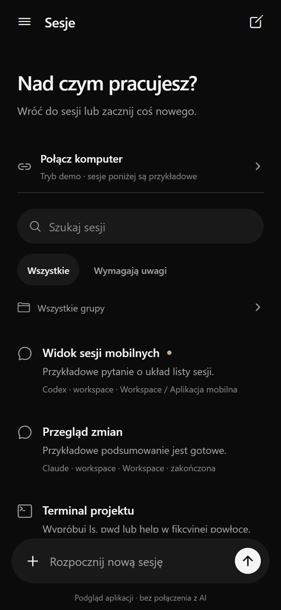
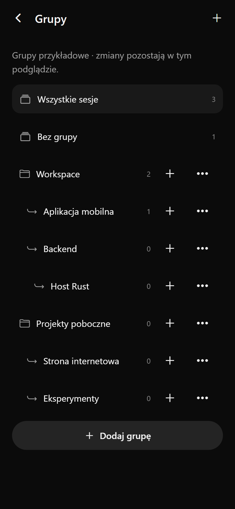
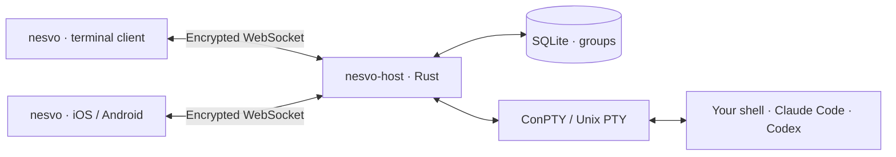

<h1 align="center">nesvo</h1>

<p align="center">
  <strong>Your terminal sessions. On your computer and in your pocket.</strong>
</p>

<p align="center">
  <a href="#quick-start">quick start</a> ·
  <a href="tui/README.md">terminal client</a> ·
  <a href="#docs">docs</a> ·
  <a href="CONTRIBUTING.md">contribute</a>
</p>

<p align="center">
  <a href="https://github.com/dkveil/nesvo/actions/workflows/ci.yml"></a>
  <a href="LICENSE"></a>
</p>

---

**Keep the process on your computer. Pick up the same session from your phone.**

nesvo brings a native terminal workspace and a mobile companion to the same Rust host. Group your sessions, watch their output on multiple devices, and hand over control when you switch screens.

<p align="center">
  
  &nbsp;&nbsp;
  
</p>

<p align="center"><sub>Current mobile web preview with demo data. The mobile interface currently uses Polish labels.</sub></p>

## what you can do

- **Pick up the same shell** — move between TUI and mobile without starting another process. Your working directory, variables and running commands stay on the host.
- **Give your work some structure** — create groups and subgroups, rename them, and move sessions between them. Changes appear on connected clients; groups persist in SQLite.
- **Watch together, control deliberately** — multiple clients see the output. One controls input and terminal size. Takeover revokes the previous controller immediately.
- **Keep working after detach** — closing a client leaves its shells running while the host stays active. Restarting the host does not restore those processes.
- **Use your existing tools** — run your shell, Git, Claude Code or Codex on the host. AI tools keep their own subscription login; nesvo does not require model API keys.
- **Stay in the terminal** — the Rust TUI has a group tree, two-pane views, keyboard and mouse navigation. Windows uses native ConPTY; no tmux or WSL is required.

## quick start

**Early development:** build from source. Signed installers and TestFlight distribution are not available yet.

Clone the repository and start the host in your project directory:

```sh
git clone https://github.com/dkveil/nesvo.git
cd nesvo
cargo run --manifest-path host/Cargo.toml -- --lan --workspace /path/to/your/project
```

Use an existing local path; on Windows, for example, `--workspace "C:\projects\my-app"`. Rust 1.88+ and your platform's native build tools are required.

In another terminal, open the desktop client:

```sh
cargo run --manifest-path tui/Cargo.toml -- --pairing host/.local/pairing.json
```

`n` creates a session · `g` / `G` create groups / subgroups · `i` takes available control · `v` splits the view. **Ctrl+G returns to navigation; `q` detaches.** [All shortcuts →](tui/README.md#keyboard)

For the mobile preview, install Node.js and run:

```sh
npm ci
npm start
```

Use `npm.cmd` on Windows if PowerShell blocks npm's script. Open the project in a compatible Expo Go, then scan the **host's separate QR code** inside nesvo. Select **Przejmij sterowanie** (take control) before typing.

Start on the same LAN. The pairing code grants shell access; keep it private. [Phone setup, Expo sign-in and networking →](docs/quick-start.md)

## how it works



The host owns processes and shared state. Each client owns its view and focus. Closing a pane or switching devices does not move or duplicate the shell.

**Rust** for the host and TUI. **Expo / React Native + TypeScript** for mobile. **xterm.js** in the mobile WebView; **Ratatui + Crossterm + vt100** in the TUI. Node.js is used for tooling and tests.

## current boundaries

Groups, live sessions and control synchronize today. Pane layouts are local and are not saved yet. Reconnect replays bounded output rather than a complete terminal screen snapshot, so full-screen programs may need a redraw.

SSH connection management, automatic relay/VPN setup and native agent conversation views are future work. Existing external terminals cannot be adopted. Physical-device and interactive platform checks are tracked in the [testing guide](docs/testing.md); CI does not replace them.

## docs

| Start here                                         | Go deeper                                       |
| -------------------------------------------------- | ----------------------------------------------- |
| [Quick start and phone setup](docs/quick-start.md) | [Architecture](docs/architecture.md)            |
| [TUI usage and shortcuts](tui/README.md)           | [Synchronization protocol](docs/protocol-v2.md) |
| [Host configuration](host/README.md)               | [Engineering conventions](docs/engineering.md)  |
| [Testing and verification](docs/testing.md)        | [Design direction](docs/design.md)              |
| [Security](SECURITY.md)                            | [Contributing](CONTRIBUTING.md)                 |

## development

```sh
npm run typecheck
npm run lint
npm run format:check
npm run test:client
cargo test --manifest-path host/Cargo.toml --locked
cargo test --manifest-path tui/Cargo.toml --locked
```

See [testing](docs/testing.md#local-checks) for real-host, browser and TUI integration checks. CI covers native Rust builds on Windows, macOS and Linux.

## license

[MIT](LICENSE). Dependencies retain their own licenses and notices.
