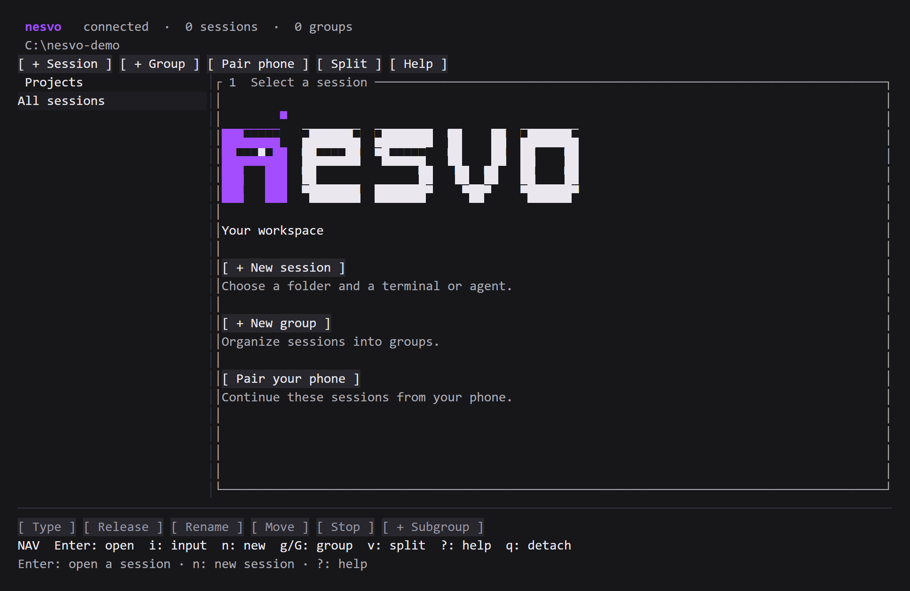
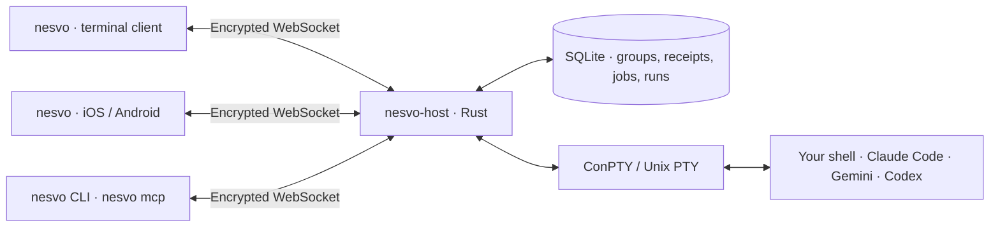

<h1 align="center">nesvo</h1>

<p align="center">
  <strong>A terminal workspace. The same sessions on your phone.</strong>
</p>

<p align="center">
  <a href="#quick-start">quick start</a> ·
  <a href="apps/tui/README.md">terminal client</a> ·
  <a href="#docs">docs</a> ·
  <a href="CONTRIBUTING.md">contribute</a>
</p>

<p align="center">
  <a href="https://github.com/dkveil/nesvo/actions/workflows/ci.yml"></a>
  <a href="LICENSE"></a>
</p>

---

**Keep the process on your computer. Pick up the same session from your phone.**

nesvo is a Rust host that owns terminal sessions for your shells and AI coding agents. A native terminal client, a mobile companion, a CLI and an MCP server connect to the same host. Group your sessions, see which agent needs you, schedule durable jobs, review changes and hand over control when you switch screens.

<p align="center">
  
</p>

<p align="center"><sub>The native terminal client's start menu. Mobile connects to the same host and sessions.</sub></p>

## what you can do

- **Pick up the same shell** — move between TUI and mobile without starting another process. Your working directory, variables and running commands stay on the host. Closing a client leaves its sessions running; restarting the host does not restore those processes.
- **Give your work some structure** — create groups and subgroups, rename them and move sessions between them. Changes appear on connected clients; groups persist in SQLite.
- **Watch together, control deliberately** — multiple clients see the output. One controls input and terminal size. Takeover revokes the previous controller immediately.
- **Start the right kind of session** — `N` offers an agent session (Claude Code, Gemini or Codex with a requested model and effort), a clean terminal or a review of the selected session's local changes. The host detects installed CLIs; AI tools keep their own subscription login and nesvo requires no model API keys.
- **See what needs attention** — clients show activity, detected questions and approvals, and process completion or failure, with needs-you rollups per group. Screen-based hints are distinguished from observed activity and exit results.
- **Arrange the workspace** — the Rust TUI has a session sidebar, tabs and a split tree of up to four panes. `L` applies, saves and renames named layouts with role panes; a project can mark one as its default. Windows uses native ConPTY; no tmux or WSL is required.
- **Schedule durable jobs** — the host runs once, cron, RRULE and externally triggered jobs without an open client, with retained history, a missed-run policy and optional prechecks. `J` opens the Jobs view to create and edit once jobs, pause them, run now and cancel occurrences; recurring schedules use `nesvo job`.
- **Run workflows** — host-owned runs with tasks, attempts, inbox messages, decision questions and budgets let a coordinator agent create and control only the worker sessions it launched. Automatic execution and wakeups stay off until enabled.
- **Review changes** — `F4` shows a session's unstaged, staged and untracked Git changes. The host opens review sessions for a local branch or a GitHub pull request fetched through `gh`, reports readiness and per-file edit provenance, and delivers review text to an agent session.
- **Drive it from scripts and agents** — `nesvo session`, `nesvo review`, `nesvo job` and `nesvo run` return stable JSON with idempotency keys and receipts. `nesvo mcp` exposes the same host operations to an orchestrating agent over stdio.
- **Pair a phone** — scan the host's QR in the Expo app to watch and control the same sessions over an encrypted connection on your LAN or private VPN.

## quick start

**Early development:** build from source. Signed installers and TestFlight distribution are not available yet.

Clone the repository and start the host in your project directory:

```sh
git clone https://github.com/dkveil/nesvo.git
cd nesvo
cargo run --package nesvo-host -- --lan --workspace /path/to/your/project
```

Use an existing local path; on Windows, for example, `--workspace "C:\projects\my-app"`. Rust 1.88+ and your platform's native build tools are required.

In another terminal, open the desktop client:

```sh
cargo run --package nesvo -- --pairing host/.local/pairing.json
```

On Windows, `scripts\nesvo-dev.cmd` builds the current client and host source, starts or reuses a development host with the private pairing `host/.local/dev/pairing.json`, and opens the client. A running host is reused, never replaced.

The start menu offers workspace, mobile pairing and settings. **F1 returns to the menu; Esc detaches without stopping sessions.** In navigation, `n` creates a session, `N` opens the session-kind menu, `d` deletes with confirmation, `g` creates a group or subgroup, `v` splits the view, `L` opens layouts and `J` opens jobs. A new session is ready for input automatically; **Ctrl+Q returns to navigation**. [All shortcuts →](apps/tui/README.md#keyboard)

For the mobile preview, install Node.js and run:

```sh
npm ci
npm start
```

Use `npm.cmd` on Windows if PowerShell blocks npm's script. Open the project in a compatible Expo Go, then scan the **host's separate QR code** inside nesvo. Select **Przejmij sterowanie** (take control) before typing.

Start on the same LAN. The pairing code grants shell access; keep it private. [Phone setup, Expo sign-in and networking →](docs/quick-start.md)

## how it works



The host is authoritative: it owns processes, control leases, jobs, runs and reviews, and records groups, operation receipts, jobs and workflow state in its SQLite journal. Each client owns only its view and focus. Closing a pane or switching devices does not move or duplicate the shell.

Every client speaks the [versioned protocol v2](docs/protocol-v2.md). New features are advertised as capabilities, so a client disables what an older host lacks. The TUI is a thin client and does not depend on the host implementation. The CLI and the MCP server are adapters over the same authenticated host commands, errors and receipts. Agents launched by nesvo get a scoped capability for their own session instead of the owner's pairing.

**Rust** for the host, TUI, CLI and MCP server. **Expo / React Native + TypeScript** for mobile. **xterm.js** in the mobile WebView; **Ratatui + Crossterm + vt100** in the TUI. Node.js is used for tooling and tests.

The monorepo has separate build boundaries:

```text
apps/mobile/                  Expo app, domain slices and mobile adapters
apps/host/                    Rust host, process lifecycle and persistence
apps/tui/                     Rust terminal interface, CLI and MCP adapter
crates/nesvo-wire/            Shared Rust encrypted-frame codec
crates/nesvo-process-fixture/ Cross-platform child process for tests
packages/brand/               Shared Ultraviolet tokens, vector mark and animation frames
tests/                        Cross-client integration and architecture checks
```

One npm workspace lock and one Cargo workspace lock keep each ecosystem consistent.

## current boundaries

Groups, live sessions, control, jobs, runs and reviews synchronize through the host. Tabs, panes and named layouts are local to each TUI: they are saved per paired host and project and never shared between devices. Reconnect replays bounded output rather than a complete terminal screen snapshot, so full-screen programs may need a redraw.

Agent status detection is conservative and depends on the CLI's visible screen and, where available, provider hooks. Unrecognized states remain unknown; silence never means a task is complete. Status hints do not approve commands or answer questions automatically. End-to-end provider coverage is Claude today: its hooks drive lifecycle status and edit provenance, while Codex's lifecycle adapter is not yet proven live and Gemini relies on screen inference. The [delivery status](docs/harness-delivery.md) lists each harness feature with its evidence and main gap.

The Jobs view edits once jobs only; recurring and external schedules and webhook triggers are managed through the CLI or MCP. A GitHub pull request review opens through the CLI or MCP; the TUI review tab and a files sidebar are in progress. Capabilities constrain the host API; they are not an OS sandbox.

SSH connection management, automatic relay/VPN setup, native agent conversation views and mobile job or decision screens are future work. Existing external terminals cannot be adopted. The native scenario cohort runs in the daily `Native nightly` workflow rather than on every push. Physical-device and interactive platform checks are tracked in the [testing guide](docs/testing.md); CI does not replace them.

## docs

| Start here                                                    | Go deeper                                           |
| ------------------------------------------------------------- | --------------------------------------------------- |
| [Quick start and phone setup](docs/quick-start.md)            | [Architecture](docs/architecture.md)                |
| [TUI usage and shortcuts](apps/tui/README.md)                 | [Synchronization protocol](docs/protocol-v2.md)     |
| [Review, layout and session workflows](docs/tui-workflows.md) | [Harness delivery status](docs/harness-delivery.md) |
| [Host configuration](apps/host/README.md)                     | [Harness CLI](docs/harness-cli.md)                  |
| [Testing and verification](docs/testing.md)                   | [MCP adapter](docs/harness-mcp.md)                  |
| [Mobile priorities](docs/mobile-roadmap.md)                   | [Durable jobs](docs/harness-jobs.md)                |
| [Security](SECURITY.md)                                       | [Workflow plans](docs/harness-workflows.md)         |
| [Contributing](CONTRIBUTING.md)                               | [Engineering conventions](docs/engineering.md)      |
|                                                               | [Design direction](docs/design.md)                  |

## development

```sh
npm run typecheck
npm run lint
npm run format:check
npm run test:client
npm run test:architecture
cargo fmt --all -- --check
cargo clippy --workspace --all-targets --locked -- -D warnings
cargo nextest run --workspace --locked --profile ci
```

Install nextest with `cargo install cargo-nextest --locked`; `cargo test --workspace --locked` is acceptable locally. CI runs nextest with a five-minute limit per test on Windows, macOS and Linux, and the `Native nightly` workflow runs the ignored native scenarios daily. See [testing](docs/testing.md#local-checks) for real-host, browser and TUI integration checks.

Each `v*` tag publishes prebuilt `nesvo-host` and `nesvo` packages with checksums on the [releases page](https://github.com/dkveil/nesvo/releases); see [contributing](CONTRIBUTING.md#releases) for how to cut one.

## license

[MIT](LICENSE). Dependencies retain their own licenses and notices.
