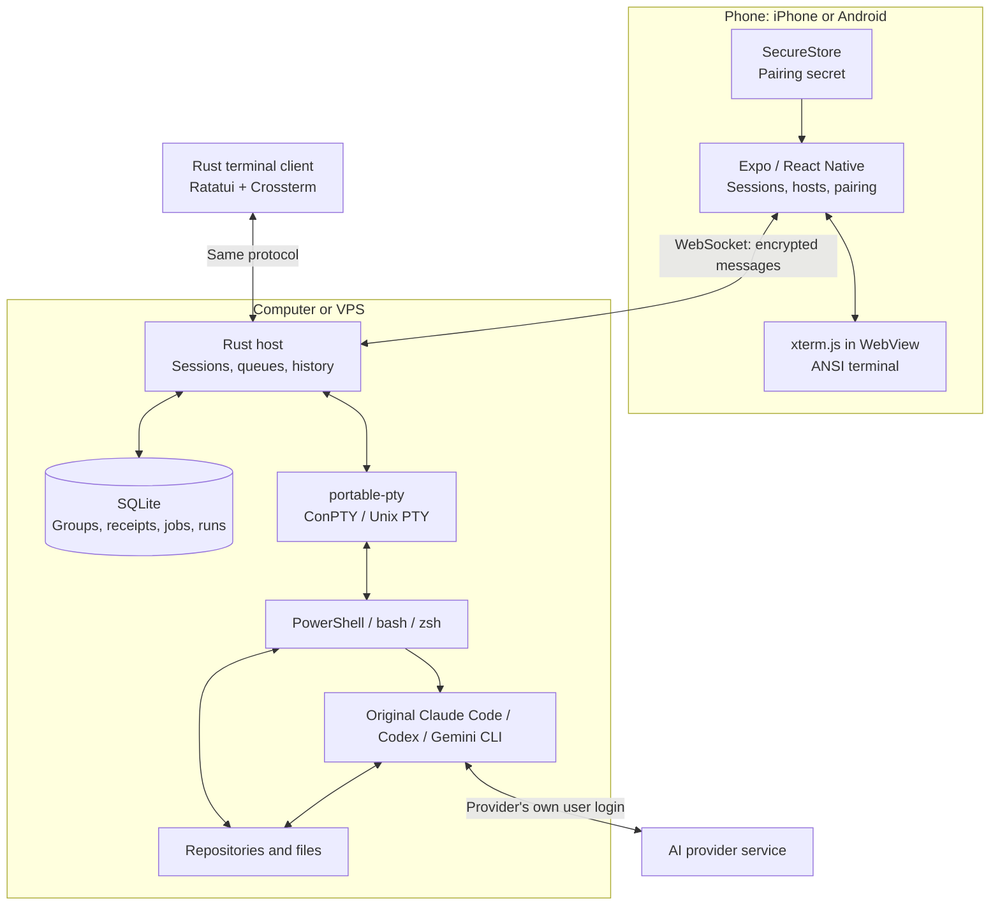

# nesvo architecture

Decision: **Expo / React Native + TypeScript on the phone, Rust on the computer or VPS**. One monorepo contains the clients, host and protocol. The host starts processes and maintains sessions; the phone provides the control interface. Node.js remains a tool for app builds and tests; the host binary does not require a Node runtime.

`apps/mobile` is an npm workspace; `apps/host`, `apps/tui` and `crates/nesvo-wire` form the Cargo workspace. Each application owns its build configuration. The shared Rust crate contains encrypted-frame encoding and decoding and the typed domain event model, so the TUI does not pull in the host's database, PTY or QR implementation. Mobile domain slices and their allowed imports are described in the [engineering conventions](engineering.md).

## Responsibilities

| Component                       | Technology                                                 | Responsibility                                                                           |
| ------------------------------- | ---------------------------------------------------------- | ---------------------------------------------------------------------------------------- |
| iOS / Android app               | React Native, Expo, TypeScript                             | Session list, pairing, navigation, keyboard, connection state                            |
| In-app terminal                 | xterm.js + local WebView                                   | ANSI interpretation, screen buffer, cursor, selection and terminal input                 |
| Browser preview                 | React Native Web + isolated iframe                         | Interface development on Windows and browser tests                                       |
| Host                            | Rust                                                       | Session ownership, processes, output history, limits and communication                   |
| Metadata and journal            | SQLite through rusqlite                                    | Groups and revisions, launch descriptions, receipts, jobs, runs and the project registry |
| Terminal client                 | Rust, Ratatui, Crossterm, vt100                            | Group tree, tabs, split panes and the jobs, runs, review, notes and projects views       |
| CLI and MCP adapters            | Rust, clap, `rmcp`                                         | `nesvo` subcommands and `nesvo mcp` over the same authenticated host commands            |
| Shell                           | `portable-pty`                                             | Windows ConPTY and Unix PTYs                                                             |
| Host networking and concurrency | Tokio, `tokio-tungstenite`                                 | Asynchronous connections, bounded queues, separate PTY readers                           |
| Protocol                        | WebSocket + versioned JSON                                 | Session creation, listing, subscriptions, control, input, output, dimensions and closing |
| Message encryption              | TweetNaCl in the mobile client, `crypto_secretbox` in Rust | Compatible XSalsa20-Poly1305 format                                                      |
| Pairing data                    | Expo SecureStore; QR scanning through Expo Camera          | Host secret saved in the phone's system storage                                          |
| Builds and distribution         | Cargo; Expo / EAS                                          | Separate host and mobile app artifacts                                                   |

`portable-pty` comes from the WezTerm project and provides a shared API for system terminals. Its implementation selects ConPTY on Windows and PTYs on Unix. A portable API does not replace testing on each system. [Library documentation](https://docs.rs/portable-pty/0.9.0/portable_pty/), [implementation selection](https://docs.rs/crate/portable-pty/0.9.0/source/src/lib.rs).

Tokio handles asynchronous connections, while blocking PTY reads run outside its networking tasks. Bounded channels prevent output from accumulating without limits for a slow client. `tokio-tungstenite` provides WebSockets over Tokio streams. [WebSocket documentation](https://docs.rs/tokio-tungstenite/0.30.0/tokio_tungstenite/), [bridging synchronous and asynchronous code](https://tokio.rs/tokio/topics/bridging).

The connection needs a reachable host address. LAN is the first testing path. A private VPN can later provide access over the internet; neither WebSocket nor a QR code solves NAT traversal. A relay and a direct SSH client are separate stages.

## Why Rust is useful here

Rust is most useful in the host process, which runs for long periods, manages multiple terminals and should be easy to install. A compiled binary lets us distribute the host without requiring users to install Node.js and npm packages. Specific system requirements still depend on the build and linked libraries. [Rust: CLI applications](https://rust-lang.org/what/cli/).

Resource ownership helps make it explicit who closes a PTY, who holds the process and what happens when a client disconnects. This is an architectural benefit, not a guarantee against bugs. Bounded buffers and correct process termination still need to be implemented and tested, regardless of language.

The cost is a second language, a separate test suite and binary builds for Windows, macOS and Linux. This project accepts that cost from the start: the host is central to the product, and installation and reliability will remain important beyond the prototype. We do not assume a performance advantage without measurements; the first bottlenecks may be the renderer, network or CLI itself.

Rust does not speed up a remote AI model, change subscription limits or grant iOS additional background-process permissions. There is currently no need to move the mobile UI or mobile terminal parser to Rust.

## Why Expo remains on the phone

Expo allows screens and logic to be shared between iOS and Android. The xterm.js renderer runs inside a WebView bundled with the app; other controls are React Native components. This is a terminal with a web renderer, rather than a custom terminal engine written in Swift. `react-native-webview` is available in Expo SDK 57. [WebView documentation for SDK 57](https://docs.expo.dev/versions/v57.0.0/sdk/webview/).

The first checkpoint is a physical iPhone: typing, special keys, scrolling, orientation changes and reconnection. A browser test cannot establish the quality of these interactions. If the renderer does not meet requirements, the terminal component can be replaced while retaining the protocol and host.

Expo Go has a fixed set of native modules. A custom Swift/Kotlin module or a Rust library accessed through a native bridge requires a development build. Expo supports that extension without rewriting the app. EAS builds iOS apps on macOS servers, so code development can take place on Windows. [Development builds](https://docs.expo.dev/develop/development-builds/introduction/), [EAS Build infrastructure](https://docs.expo.dev/build/introduction/).

## Sessions and prototype boundaries

The host owns sessions. Losing the WebSocket connection does not terminate the shell. Reconnecting replays bounded output history; it does not guarantee a perfect reconstruction of every full-screen program. Stopping the host or computer ends that continuity. We do not take over arbitrary terminals previously opened in another program.

Claude Code, Gemini and Codex remain the original programs. Session creation selects a detected host program and an existing working directory; the host starts it directly with structured arguments. The phone does not extract their OAuth tokens or turn a subscription into its own API access. Host reviews of local changes and pull requests and workflow decisions are real host features; mobile conversation views and native permission approvals are not, and need separate adapters and verification of the providers' official interfaces and policies.

The host saves groups and their revisions, saved launch descriptions and its durable journal in local SQLite. The process list, live sessions' group assignments and output buffers belong to the host process. After a restart, groups remain and previous shells are not restored; the owner can start a new process from a saved launch description. No cloud service is required.

Multiple clients can subscribe to the output of the same session. A separate control lease determines who can send input and set the PTY dimensions. Takeover is explicit, creates a new lease and invalidates the previous one. A viewer neither resizes the process nor answers terminal queries. Metadata uses revisions, and session creation uses `requestId` correlation, so names are not used to identify responses. Details: [v2 contract](protocol-v2.md).

Module boundaries, data validation and testing rules are described in the [engineering conventions](engineering.md).

## Protocol and trust

Pairing transfers the host address and a random 32-byte secret. This is a shell-access credential, not an AI provider API key. The QR code is reusable and must not be presented as a one-time invitation. SecureStore protects storage in the native client using iOS and Android facilities. The browser client keeps pairing data only in page memory. [Expo SecureStore](https://docs.expo.dev/versions/v57.0.0/sdk/securestore/).

A secretbox message contains the current connection challenge, direction, sequence number and command data. The client adds its own fresh 32-byte nonce to the encrypted authentication request and requires the authenticated host response to echo it. This prevents a recorded handshake from impersonating a fresh connection to the host. Every message also uses a random 24-byte cipher nonce. The receiver verifies authentication and the expected message number; it does not automatically resend typed commands after reconnecting. The key is not sent in the URL or WebSocket handshake.

The secretbox format was chosen for compatibility between the current TweetNaCl client and Rust host. The `crypto_secretbox` library states that it has not undergone an independent audit; the entire protocol also needs review before production deployment. Payload encryption does not hide traffic metadata or protect against a compromised phone or computer. The prototype is intended for LAN or private VPN use, without exposing the host directly to the internet. [RustCrypto secretbox documentation](https://docs.rs/crypto_secretbox/0.1.1/crypto_secretbox/).

## Further uses of Rust

- Packaging the host as a service and signed binaries for three operating systems.
- A shared SSH module or stream parser, if measurements and requirements justify a native library.
- An optional desktop app using the existing host. Choosing its framework is unnecessary for the current mobile version.

Architecture status: October 22, 2026. The [test matrix](testing.md) records checks actually performed and remaining device tests.
