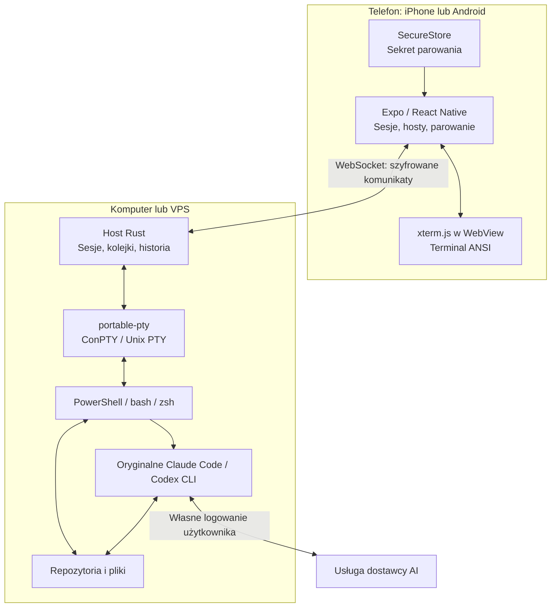

# Architektura Pocket Sessions

Decyzja: **Expo / React Native + TypeScript na telefonie, Rust na komputerze lub VPS-ie**. Jeden monorepo obejmuje klienta, hosta i protokół. Host uruchamia procesy i utrzymuje sesje, a telefon jest interfejsem sterowania. Node.js pozostaje narzędziem do budowania aplikacji i testów; docelowa binarka hosta nie wymaga środowiska Node.

## Podział odpowiedzialności

| Część | Technologia | Odpowiedzialność |
| --- | --- | --- |
| Aplikacja iOS / Android | React Native, Expo, TypeScript | Lista sesji, parowanie, nawigacja, klawiatura, stan połączenia |
| Terminal w aplikacji | xterm.js + lokalny WebView | Interpretacja ANSI, bufor ekranu, kursor, zaznaczanie i wejście terminalowe |
| Podgląd w przeglądarce | React Native Web + izolowany iframe | Rozwijanie interfejsu na Windowsie i testy przeglądarkowe |
| Host | Rust | Własność sesji, procesy, historia wyjścia, limity i komunikacja |
| Powłoka | `portable-pty` | Windows ConPTY oraz PTY na systemach Unix |
| Sieć i współbieżność hosta | Tokio, `tokio-tungstenite` | Asynchroniczne połączenia, ograniczone kolejki, oddzielne odczyty PTY |
| Protokół | WebSocket + wersjonowany JSON | Tworzenie, lista, dołączanie, wejście, wyjście, rozmiar i zamykanie sesji |
| Szyfrowanie komunikatów | TweetNaCl w kliencie, `crypto_secretbox` w Rust | Zgodny format XSalsa20-Poly1305 |
| Dane parowania | Expo SecureStore; QR przez Expo Camera | Sekret hosta zapisany w magazynie systemowym na telefonie |
| Budowanie i dystrybucja | Cargo; Expo / EAS | Osobne artefakty hosta oraz aplikacji mobilnej |

`portable-pty` pochodzi z projektu WezTerm i udostępnia wspólne API do terminali systemowych. Jego implementacja wybiera ConPTY na Windowsie oraz PTY na Unixie. Przenośne API nie zastępuje testów na każdym systemie. [Dokumentacja biblioteki](https://docs.rs/portable-pty/0.9.0/portable_pty/), [wybór implementacji](https://docs.rs/crate/portable-pty/0.9.0/source/src/lib.rs).

Tokio obsługuje połączenia asynchroniczne, a blokujące odczyty PTY są wykonywane poza jego zadaniami sieciowymi. Ograniczone kanały zapobiegają niekontrolowanemu kolejkowaniu wyjścia dla wolnego klienta. `tokio-tungstenite` dostarcza WebSocket oparty na strumieniach Tokio. [Dokumentacja WebSocket](https://docs.rs/tokio-tungstenite/0.30.0/tokio_tungstenite/), [łączenie kodu synchronicznego i asynchronicznego](https://tokio.rs/tokio/topics/bridging).

Połączenie potrzebuje osiągalnego adresu hosta. LAN jest pierwszą ścieżką testową. Prywatny VPN może później zapewnić dostęp z internetu; sam WebSocket ani QR nie rozwiązują NAT-u. Własny relay i bezpośredni klient SSH są osobnymi etapami.

## Dlaczego Rust jest tu użyteczny

Największy sens ma w procesie hosta, który działa długo, obsługuje wiele terminali i powinien być łatwy do zainstalowania. Kompilowana binarka pozwala dostarczać hosta bez instalowania Node.js i pakietów npm u użytkownika. Konkretne wymagania systemowe nadal zależą od sposobu kompilacji i dołączanych bibliotek. [Rust: aplikacje CLI](https://rust-lang.org/what/cli/).

Kontrola własności zasobów pomaga jawnie określić, kto zamyka PTY, kto przechowuje proces i co dzieje się po odłączeniu klienta. To korzyść architektoniczna, nie gwarancja braku błędów. Ograniczone bufory i poprawne kończenie procesów trzeba zaprogramować i sprawdzić niezależnie od języka.

Koszt wyboru to drugi język, oddzielny zestaw testów oraz budowanie binarek dla Windowsa, macOS i Linuksa. Dla tego projektu akceptujemy go od początku: host jest centralną częścią produktu, a jego instalacja i niezawodność będą ważne także po prototypie. Nie zakładamy przewagi wydajności bez pomiarów; pierwsze ograniczenia mogą wynikać z renderera, łącza lub działania samego CLI.

Rust nie przyspiesza zdalnego modelu AI, nie zmienia limitów abonamentu i nie daje iOS dodatkowych uprawnień do procesów w tle. Nie ma obecnie potrzeby przenoszenia mobilnego UI ani parsera terminala do Rusta.

## Dlaczego Expo pozostaje na telefonie

Expo pozwala współdzielić ekran i logikę między iOS i Androidem. Renderer xterm.js działa wewnątrz WebView dołączonego do aplikacji; pozostałe kontrolki są komponentami React Native. Jest to terminal z webowym rendererem, a nie własny silnik terminala napisany w Swift. `react-native-webview` jest dostępny w zestawie Expo SDK 58. [Dokumentacja WebView dla SDK 58](https://docs.expo.dev/versions/v58.0.0/sdk/webview/).

Pierwszy punkt kontrolny to fizyczny iPhone: wpisywanie, klawisze specjalne, przewijanie, zmiana orientacji i przywracanie połączenia. Test w przeglądarce nie rozstrzyga jakości tych interakcji. Jeżeli renderer nie spełni wymagań, można wymienić komponent terminala, zachowując protokół i hosta.

Expo Go ma ustalony zestaw modułów natywnych. Własny moduł Swift/Kotlin lub ewentualna biblioteka Rust przez natywny most wymaga development buildu. Expo umożliwia taką rozbudowę bez przepisywania całej aplikacji. EAS buduje aplikacje iOS na serwerach macOS, więc pracę nad kodem można prowadzić na Windowsie. [Development builds](https://docs.expo.dev/develop/development-builds/introduction/), [infrastruktura EAS Build](https://docs.expo.dev/build/introduction/).

## Sesja i granice prototypu

Host jest właścicielem sesji. Zerwanie WebSocketu nie oznacza zakończenia powłoki. Ponowne dołączenie odtwarza ograniczoną historię wyjścia; nie gwarantuje idealnego odtworzenia każdego programu pełnoekranowego. Zatrzymanie hosta lub komputera kończy tę ciągłość. Nie przejmujemy dowolnego terminala otwartego wcześniej w innym programie.

Claude Code i Codex pozostają oryginalnymi programami uruchamianymi przez użytkownika na hoście. Telefon nie pobiera ich tokenów OAuth i nie zamienia abonamentu w własny dostęp do API. Widoki rozmów, zgód i zmian są obecnie demonstracją; ich rzeczywista integracja wymaga osobnych adapterów i sprawdzenia oficjalnych interfejsów oraz zasad dostawców.

Pierwszy host nie potrzebuje bazy danych ani usługi chmurowej. Lista sesji i bufor wyjścia należą do procesu hosta. Trwałe metadane, wznowienie po restarcie, wiele zaufanych urządzeń i odwoływanie ich uprawnień są kolejnymi funkcjami.

## Protokół i zaufanie

Parowanie przenosi adres hosta i losowy 32-bajtowy sekret. Jest to poświadczenie dostępu do powłoki, a nie klucz API dostawcy AI. QR jest wielokrotnego użytku; nie należy przedstawiać go jako jednorazowego zaproszenia. SecureStore chroni zapis na natywnym kliencie przy użyciu mechanizmów iOS i Androida. Klient przeglądarkowy zachowuje parowanie tylko w pamięci strony. [Expo SecureStore](https://docs.expo.dev/versions/v58.0.0/sdk/securestore/).

Komunikat secretbox zawiera challenge bieżącego połączenia, kierunek, numer kolejny i dane polecenia. Klient dodaje własny świeży 32-bajtowy nonce do zaszyfrowanego żądania uwierzytelnienia i wymaga jego powtórzenia w uwierzytelnionej odpowiedzi hosta. Dzięki temu odtworzenie nagranego handshake nie udaje nowego połączenia z hostem. Każda wiadomość używa dodatkowo losowego 24-bajtowego nonce szyfru. Odbiorca weryfikuje uwierzytelnienie i oczekiwany numer wiadomości; nie odtwarza automatycznie wpisanych poleceń po reconnect. Klucz nie jest wysyłany w URL-u ani w handshake WebSocketu.

Format secretbox wybrano dla zgodności między obecnym klientem TweetNaCl a hostem Rust. Biblioteka `crypto_secretbox` deklaruje brak niezależnego audytu; cały protokół również wymaga przeglądu przed wdrożeniem produkcyjnym. Szyfrowanie treści nie ukrywa metadanych ruchu i nie chroni przed przejętym telefonem lub komputerem. Prototyp jest przeznaczony do LAN-u albo prywatnego VPN-u, bez bezpośredniego wystawiania hosta do internetu. [Dokumentacja RustCrypto secretbox](https://docs.rs/crypto_secretbox/0.1.1/crypto_secretbox/).

## Kolejne zastosowania Rusta

- Pakowanie hosta jako usługi i podpisanych binarek dla trzech systemów.
- Zarządzanie katalogami projektów i worktree na hoście, z jawnymi operacjami i limitami.
- Wspólny moduł SSH lub parser strumieni, jeśli pomiary i wymagania uzasadnią bibliotekę natywną.
- Opcjonalna aplikacja desktopowa korzystająca z istniejącego hosta. Wybór jej frameworka nie jest potrzebny do obecnej wersji mobilnej.

Stan architektury: 16 października 2026. Wyniki faktycznie wykonanych sprawdzeń i pozostałe testy urządzeń opisuje [macierz testów](testing.md).
