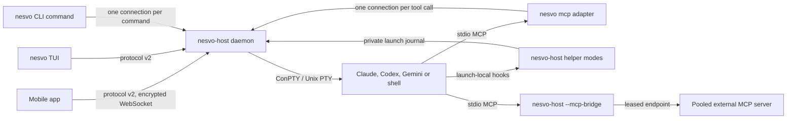

# Engine map

One page on what the Rust engine does and how to see what it is doing, without
reading the code. Every section ends with the document that holds the full
contract. Where this page and a detailed document disagree, the detailed
document and the code win; report the difference.

## Processes and how they talk

| Process                   | Binary                                   | Role                                                                                                                                                                                                                                                                                                                                   |
| ------------------------- | ---------------------------------------- | -------------------------------------------------------------------------------------------------------------------------------------------------------------------------------------------------------------------------------------------------------------------------------------------------------------------------------------- |
| Host daemon               | `nesvo-host`                             | Owns every session, process, lease, job, run and the SQLite ledger. One host per data directory (`host.lock`). Listens on `127.0.0.1:8787` by default, `--lan` for all interfaces.                                                                                                                                                     |
| Host helper modes         | `nesvo-host` with a hidden flag          | Short-lived children started by providers or by the host: lifecycle hooks (`--agent-context-hook`, `--codex-context-hook`, `--gemini-context-hook`), Claude statusline capture, the MCP bridge (`--mcp-bridge LEASE_FILE`), the Git repository helper, worktree steps, precheck and calendar adapters. They never start a second host. |
| TUI, CLI and MCP adapter  | `nesvo`                                  | `nesvo` alone opens the TUI (one long-lived connection). `nesvo SUBCOMMAND --json` runs one command and prints one envelope. `nesvo mcp` serves MCP over stdio and authenticates again for every tool call.                                                                                                                            |
| Provider sessions         | the original `claude`, `codex`, `gemini` | Started directly (no shell string) under a PTY with the owner's own login. Harness Claude sessions also receive a launch-local `--mcp-config` that starts `nesvo mcp` and, for approved external servers, the bridge.                                                                                                                  |
| Controlled worker fixture | `tests/fixtures/scoped-agent.cjs`        | A Node program installed under provider names in native scenarios. It answers `--version`, writes the same hooks and reports results, and never calls a model. `crates/nesvo-process-fixture` plays process trees for host tests.                                                                                                      |
| Mobile app                | `apps/mobile` (Expo)                     | Same protocol as the TUI over the paired WebSocket; its contract types are generated from the published schemas.                                                                                                                                                                                                                       |

**Protocol v2.** Every frame is a secretbox message with the connection
challenge, direction and sequence number; plaintext is at most 64 KiB and the
host accepts 16 connections. After authentication the client asks for
`capabilities` and sends only the commands whose flag is `true`. Session-scoped
callers (an agent inside a managed session) present a private per-launch key
instead of the owner pairing and see only what that scope allows.
[Protocol v2](protocol-v2.md), [architecture](architecture.md),
[terminal client](terminal-client.md).

**CLI envelopes.** `--json` prints `{schemaVersion:1, ok, data|error}`; the exit
code says what to do next (0 success, 1 bad request, 2 host unreachable, 3
authority, 4 host error, 5 state moved on). Every reply is typed and generated
into `docs/harness-cli.schema.json`. [Harness CLI](harness-cli.md).

**MCP.** The `nesvo` server is the same host API as the CLI with a generated tool
catalog, plus `nesvo://events` resources for waiting on the journal.
[MCP adapter](harness-mcp.md).

## Where state lives

| Place                            | What it holds                                                                                                                                                         | Survives a host restart         |
| -------------------------------- | --------------------------------------------------------------------------------------------------------------------------------------------------------------------- | ------------------------------- |
| `metadata.sqlite3` (WAL)         | Groups, saved launch descriptions, receipts, the domain journal, runs, tasks, attempts, jobs, triggers, budgets, projects, hibernation records and the restore report | Yes                             |
| `pairing.json`, `pairing.svg`    | The reusable 32-byte pairing key and its QR                                                                                                                           | Yes                             |
| `host.lock`                      | Exclusive OS lock of the data directory; the file existing proves nothing                                                                                             | Released by the OS on exit      |
| `worktrees.json`                 | Host-created worktree registry and approved `nesvo.toml` setup digests (which also approve `[[mcp.server]]` declarations)                                             | Yes                             |
| `workflow-templates.json`        | Approved `[[workflow]]` template digests                                                                                                                              | Yes                             |
| Notes                            | Plain Markdown in `<repository>/.nesvo/notes` or `<config>/nesvo/notes/<hostId>`                                                                                      | Yes, outside the data directory |
| Per-launch private folder (temp) | Scoped context file, launch journal (hook events), `mcp.json`, recovery report, MCP lease files                                                                       | Removed with the session        |
| Host memory only                 | Live sessions, output replay (128 KiB per session), control leases, reviews, quota holds, session inbox revisions                                                     | No                              |

The data directory defaults to `host/.local/` when the host runs from the
repository, otherwise `%LOCALAPPDATA%/PocketSessions/pairing` or
`$XDG_STATE_HOME/pocket-sessions`. [Host configuration](../apps/host/README.md),
[backup and restore](harness-operations.md#backup-and-restore),
[data-directory ownership](host-directory-ownership.md).

**Migrations.** Startup applies pending numbered files from `apps/host/migrations/`
in one immediate transaction and refuses a database written by a newer host.
Tables that existed before the ledger (`domain_events`, `operation_receipts`,
groups and recovery records) are created by their own frozen initializers.
[Writer admission](harness-transactions.md),
[engineering conventions](engineering.md#protocol-persistence-and-tests).

| File                                     | Purpose                                                                                                                                                       |
| ---------------------------------------- | ------------------------------------------------------------------------------------------------------------------------------------------------------------- |
| `0001_initial`                           | Runs, tasks, attempts, inbox, decisions, controls, executors, wakes, checkpoints, jobs, prechecks, retries, timeouts, triggers, quota sources and host budget |
| `0002_workflow_launch_profile`           | Requested model and effort profile on a task launch                                                                                                           |
| `0003_workflow_launch_preparation`       | Prepared launch spec, derived worktree flag and quota hold reason on a task launch                                                                            |
| `0004_job_calendar_error`                | Durable calendar evaluation error on a job definition                                                                                                         |
| `0005_job_occurrence_coalescing`         | `coalescedFrom` when downtime merged several due slots                                                                                                        |
| `0006_job_cancellation_precheck_attempt` | Ties a cancellation to the exact precheck generation                                                                                                          |
| `0007_job_occurrence_current_attempt`    | Pointer from an occurrence to its current dispatch generation                                                                                                 |
| `0008_attention_receipts`                | Owner inbox acknowledgements per item revision                                                                                                                |
| `0009_projects`                          | Project registry and per-project launch folders                                                                                                               |
| `0010_workflow_session_reuse`            | Reusing a task's own settled worker session; rebuilt exit, timeout and attempt tables                                                                         |
| `0011_workflow_digests`                  | Final run digest records                                                                                                                                      |
| `0012_job_retry_classes`                 | `noEffect`, `uncertainEffect` and `definiteEffect` retry decisions with probes                                                                                |
| `0013_wake_delivery`                     | Owner wake hold and delta or full delivery mode                                                                                                               |
| `0014_session_hibernation`               | Hibernation records (`stopping`, `hibernated`, `resuming`) and their idempotency keys                                                                         |
| `0015_session_restore`                   | The restore report: `pending`, `restored`, `hibernated` or `reaped` per session after a stop                                                                  |

**Journal and typed events.** Every durable change appends a typed domain event
(`session.*`, `operation.changed`, `run.*`, `job.changed`, `worktree.*`,
`mcp.*` and others) to `domain_events`, retained for the last 4096 events. Events
carry IDs and phases, never prompts or tool arguments. Readers keep a cursor; a
`gap:true` page means history expired and state must be re-read.
[Domain events](harness-events.md).

**Restore report.** A graceful stop writes one row per session into
`session_restore_outcomes` (at most 256); the next start fills in the outcome.
It is shown as `sessionRestore` in `nesvo doctor --json`.
[Restore after a host restart](harness-recovery-context.md#restore-after-a-host-restart).

## Life of a session

1. **Create.** A client sends `create`, `launch` or `createOperation {key,spec}`.
   The keyed form commits a receipt (`accepted`) and reserves the session ID
   before any effect, so a repeated key returns the same receipt and never a
   second process. [Durable operations](harness-operations.md).
2. **Admission.** The host checks the session, worker and per-provider budgets
   (default 8, ceiling 16) and the provider **quota gate**: `allow`, `hold` (a
   known limit; the request waits or is refused with `quota_hold`) or `unknown`
   (starts and is marked `quotaUnverified`). After a restart each provider holds
   for at most 30 seconds until its first quota read.
   [Budgets](harness-budgets.md), [quota gate](harness-quota-jobs.md#host-wide-gate).
3. **Version probe.** At startup the host runs each provider's `--version` once
   (ten-second deadline). A failed or timed-out probe is retried at the next
   launch of that provider. Harness launches, model profiles and the job
   scheduler wait for this answer. [Model profiles](harness-model-profiles.md).
4. **Spawn.** The provider starts directly under a PTY in the chosen folder (or a
   new `nesvo/…` worktree after its approved setup passed), with launch-local
   hooks, a private scoped context and, for harness Claude sessions, the MCP
   configuration. On Windows the root joins its own kill-on-close job before any
   I/O thread starts. The receipt becomes `created`, which proves process creation
   only. [Worktree setup](harness-cli.md#worktree-setup-run-and-archive).
5. **Readiness.** `readiness.phase` goes `starting` → `ready` (or `waiting` for a
   trust or consent screen, `timedOut` after 45 seconds without semantic
   evidence, `exited`). Output alone is never readiness.
   [Agent session status](agent-session-status.md).
6. **Status.** Each session carries `status {state, source}` from the strongest
   live source ([signal matrix](provider-signals.md)):
   - **hooks**: provider lifecycle hooks write to the launch journal, read every
     500 ms; they are the only source of turns and settled responses. Stale after
     4000 ms without a read.
   - **statusline capture**: opt-in Claude statusline that records quota windows.
   - **screen rules**: `apps/host/status-rules/v1.json` matched on the host's own
     VT model of the current screen; inference only.
   - **OSC 133 marks**: a shell prompt that emits them is idle at its prompt and
     working during a command; the last exit code is diagnostic only.
   - **process exit** is final; **activity** (I/O timing) is never semantic.
7. **Send.** `sendOperation {key,sessionId,prompt}` writes a paste and then Enter
   as two writes. Before each write a **submission fence** waits until pending
   lifecycle evidence settles, rechecking human control, run guards and
   conversation identity; it ends at the latest 45 seconds after that write step
   began, counted from its own start rather than from terminal activity. Between
   paste and Enter the **editor readiness guard** refuses Enter while only I/O
   activity is visible (`editor_pending`) and waits for fresh idle evidence;
   semantic working evidence refuses Enter at once. Phases: `delivered` →
   `received` → `started` → `settled`. Once the paste was queued every failure is
   `unknown`, never a retryable no-effect.
   [Prompt submission](harness-operations.md#prompt-submission-and-correlated-wait),
   [editor redraw](harness-operations.md#editor-redraw-between-paste-and-enter).
8. **Hibernate.** The owner (or the optional idle policy) stops an idle agent's
   process while the host keeps its ID, conversation ID, folder, group and
   attention. A list of refusal codes guards it (human control, draft, pending
   submission, active children, armed wake, unsettled attempt…).
   [Hibernation](harness-recovery-context.md#safe-resumable-hibernation).
9. **Graceful stop and restore.** Ctrl+C (or a closed stdin under
   `--exit-on-stdin-close`) hibernates every eligible session with
   `trigger:"shutdown"` within ten seconds, children first, and reaps the rest.
   The next start resumes exactly those, at most two at a time, each first
   passing the quota gate, through the exact conversation resume gate (the
   provider must report a `resume` session start for the recorded ID within 65
   seconds). `--no-restore-on-start` keeps them hibernated. A crash or forced kill
   skips this: nothing is owed a restore.
10. **Exit.** An observed exit becomes `process.exited` and `status.source:process`.
    The session and its replay stay visible until closed; its saved launch
    description stays in recovery. Exit is never task success.

## Life of a job

1. **Admission.** A once, cron or RRULE timer, `run-now` or a signed external
   trigger creates an occurrence. Misfire (`skip`, `catchUp` within `graceMs`)
   and overlap (`skip`, `queue` of one) apply; at most four new or retry
   generations are claimed per host tick. Without a `quotaPolicy` the quota gate
   can hold it `queued`. [Jobs](harness-jobs.md), [calendars](harness-job-calendars.md),
   [triggers](harness-job-triggers.md), [quota admission](harness-quota-jobs.md).
2. **Precheck.** An optional owner-approved command runs in its own contained
   process scope before any Run exists; only a pass with confirmed cleanup lets
   the job continue. [Prechecks](harness-job-prechecks.md).
3. **Dispatch.** The host creates a Run, plan, budget and activation and starts
   the executor with deterministic keys `job:JOB:OCCURRENCE[:attempt:N]:…`. The
   executor launches the worker through the atomic task launch, which reserves
   the attempt and the native create receipt before the process starts, then
   queues the literal instruction. [Executor](harness-executor.md),
   [task launch](harness-task-launch.md), [task delivery](harness-task-delivery.md).
4. **Receipts and results.** Native effects are pointers to receipts. A worker
   report moves the occurrence to `needsValidation`; only an explicit validation
   makes it `succeeded`. Idle, exit or a settled response never does.
   [Workflows](harness-workflows.md).
5. **Retry classes.** With an opt-in `retry` policy a failed generation is
   classified: `noEffect` (a create receipt with `effectStarted:false`),
   `uncertainEffect` (`reconcile` with `dispatch_unconfirmed`,
   `dispatch_interrupted`, `launch_unconfirmed` or `host_restarted`, probed twice
   in the journal before a fresh generation) or `definiteEffect` (a probe found
   the work, which is adopted, never repeated).
   [Retry classes](harness-jobs.md#retry-classes).
6. **Executor pause.** When an uncertain probe finds nothing, the old Run's
   executor is paused with `job_retry_waiting` in the same transaction, so it
   can never admit another effect; enabling it again is refused.
7. **Graceful stop.** A dispatch still in flight is recorded `reconcile` with
   `host_stopping`, not failed. The next start hands it to the retry
   classification as `host_restarted`. A running precheck is refused with
   `host_shutdown`. [Graceful host stop](harness-operations.md#graceful-host-stop).
8. **Timeouts and cancellation.** An optional execution timeout and owner
   cancellation fence further automated input and request a stop of the exact
   bound worker; acceptance is not exit.
   [Timeouts](harness-job-timeouts.md), [cancel](harness-jobs.md#cancel-one-occurrence).
9. **Wakes, decisions and inbox.** A run's coordinator can opt into wakes:
   coalesced notices of new messages and worker attention, sent through the same
   guarded input. Workers ask attempt-bound decisions that the owner or
   coordinator answers. Run messages live in a durable workflow inbox with exact
   acknowledgement; the owner's attention inbox aggregates sessions that need
   you, pending decisions and finished job results.
   [Wakes](harness-wakes.md), [decisions](harness-decisions.md),
   [workflow inbox](harness-inbox.md),
   [owner inbox](harness-cli.md#owner-attention-inbox-and-decisions).

## Windows process model

- **ConPTY ownership.** Each session uses the system `conhost.exe`: before the
  first pseudo console the host restricts DLL search to System32, so a
  third-party `conpty.dll` on `PATH` is never loaded.
- **Kill-on-close jobs.** The PTY root joins a private job right after spawn and
  its descendants inherit it. Stop, a natural root exit and dropping the session
  all terminate the job; a host crash closes the handle and Windows ends the
  members. Prechecks, worktree steps, the Git helper and pooled MCP servers each
  get their own job. Unix uses process groups instead.
- **Settlement at shutdown.** Before exiting, the host waits for every recorded
  session job until its console handle is released, the job reports no active
  process and every pinned member has ended. The wait is woken by the job's
  completion port and shares the eight-second terminal cleanup bound. A job
  still busy at the bound is printed on the host log and the host still exits.

[Session process ownership](windows-process-ownership.md).

## External MCP servers, pool and bridge

A repository declares stdio servers as `[[mcp.server]]` in its committed
`nesvo.toml`. They belong to the worktree setup digest, so the owner approves
them with `nesvo worktree approve-setup`; the host never approves by itself. For
harness Claude sessions the host writes one entry per approved server whose
command is `nesvo-host --mcp-bridge LEASE_FILE`. At launch the host asks the
pool for a lease: `pooled` (a warm process prepared earlier, reached through a
one-connection local endpoint and a 256-bit token) or `cold` and `dedicated`
(the bridge starts the server itself). Every bridge start re-checks the approval
first and exits with code 3 when it was revoked. Each warm process serves one
session only and is killed when the lease ends; the host keeps at most four warm
and leased processes. Codex and Gemini sessions get no host MCP configuration,
and the `nesvo` server itself always runs dedicated because it carries the
session credential. `nesvo mcp pool status` and `nesvo mcp servers --directory
DIR` show the state. [Warm server pool](harness-mcp.md#warm-server-pool),
[external servers](harness-mcp.md#external-mcp-servers),
[measurements](engineering.md#measurements).

## How to observe the engine

| Tool                                    | What it tells you                                                                                                                                                                                                                                     |
| --------------------------------------- | ----------------------------------------------------------------------------------------------------------------------------------------------------------------------------------------------------------------------------------------------------- |
| `nesvo doctor --json`                   | Host build, protocol, programs and `providerVersions`, journal health (`eventJournal`), `providerQuota`, `lifecycleObserver` counters, Gemini integration, job trigger listener, launch profile support and `sessionRestore` (policy and last report) |
| `nesvo session explain ID --json`       | One session: selected status and its reason, hook state and sequence, matched screen rule, `shellMarks`, readiness, turn, integration delivery, last input operation with `correlationEvidence`, harness configuration, freshness                     |
| `nesvo operation --key KEY --json`      | The receipt of a create, send, interrupt or stop: phase, `effectStarted`, `submissionStage`, `submissionFence`                                                                                                                                        |
| `nesvo events --after N [--session ID]` | The journal page; `--watch` streams it                                                                                                                                                                                                                |
| `nesvo quota --json`                    | Quota observations, the gate verdict per provider and every hold                                                                                                                                                                                      |
| `nesvo job occurrence` / `job attempts` | One occurrence, its generations, retry classification and probes                                                                                                                                                                                      |
| Scenario stderr                         | Native scenarios print `NESVO_WAIT <what> observed <state>` whenever a wait sees a state change; the last line of a hung scenario names what it was waiting for ([waits](testing.md#waits-without-a-clock-of-their-own))                              |
| `NESVO_STARTUP_DIAGNOSTICS=1`           | Startup phase lines `NESVO_STARTUP_PHASE` up to readiness ([startup diagnostics](host-startup-diagnostics.md))                                                                                                                                        |

**Host log at shutdown.** A clean graceful stop prints none of the lines below.
Each one names a step that did not confirm, and the host still exits: `The shutdown restore report
was not recorded`, `Job dispatch OCCURRENCE shutdown record is unconfirmed`,
`Provider quota observation cleanup is unconfirmed`, `Quota wake dispatch
cleanup is unconfirmed`, `Session repository metadata cleanup is unconfirmed`,
`Session job ID did not release its console host within the shutdown bound`,
`Session job ID still had active processes at the shutdown bound`, `Session job
ID process accounting failed`, `Session job settlement was interrupted`. These
end the host with an error instead: `Job runtime shutdown cleanup was not
confirmed within five seconds`, `Timed out waiting for N terminal cleanup
workers` and `Event journal shutdown timed out`. At the next start, `Sessions
from the last shutdown were not restored` and `The restore outcome was not
recorded` report a failed restore pass.

## Debug a stuck session in five steps

1. **Is it the host?** `nesvo doctor --json`: the session is listed, the journal
   has no `writeFailures`, the provider version is `ready`, and `sessionRestore`
   does not show it `hibernated` or `reaped` with a code.
2. **What does the host believe?** `nesvo session explain ID --json`: read
   `status.selected` and its reason, `readiness.phase`, the turn phase and the
   hook freshness. `stale` with `source:"journal"` means hook delivery stopped,
   not that the agent finished. `hibernation` present means no process runs.
3. **What happened to the last request?** `nesvo operation --key KEY --json`:
   `accepted` or `dispatching` is still in flight; `unknown` with
   `submissionStage` names the step that lost evidence. Never retry with a new
   key; repeat the same key.
4. **What did the engine record?** `nesvo events --session ID --after 0 --json`
   for `operation.changed`, `agent.lifecycle`, `response.settled`,
   `session.hibernated` and `session.resumed`, and `nesvo quota --json` for a
   quota hold.
5. **What is on the screen?** `nesvo session read ID --max-bytes 4096` shows the
   terminal tail (a permission dialog, a login screen, a quota message). Then act
   deliberately: answer in the TUI, `nesvo session interrupt ID --key KEY`, or
   `nesvo session stop ID --key KEY`, and watch for `process.exited`.
