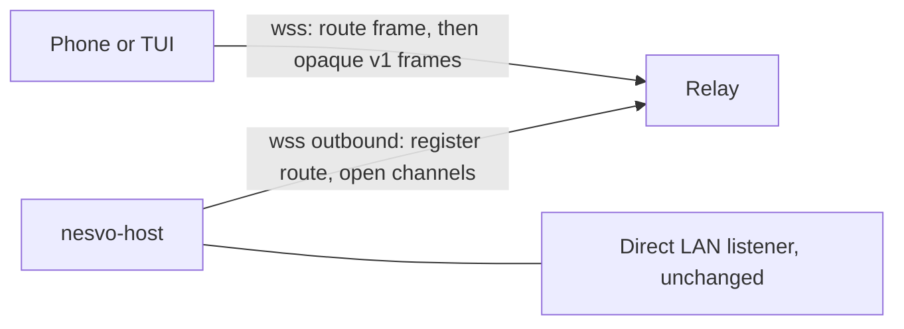

# Relay transport design

**Status: design, not implemented.** Nothing in this document is advertised by a
host, accepted by a client or covered by a test. Names such as `relayTransport`,
`--relay`, `route` frames and the `relay` pairing field are proposals. Every
statement about current behavior cites the existing contract; every statement
marked **Assumption** still needs confirmation by the owner or by an experiment.

Today a client needs a reachable host address. The [architecture](architecture.md)
names LAN as the first path, a private VPN as the later internet path and "a relay
and a direct SSH client" as separate stages. [Quick start](quick-start.md) states
that nesvo "does not configure it or provide a relay", and the
[host README](../apps/host/README.md) describes "a LAN prototype with no relay,
TLS endpoint identity, per-device keys or forward secrecy". This document designs
that relay stage. No row of the [harness delivery table](harness-delivery.md)
covers relay or remote access; F43 (mobile fleet and pushes) and F16 (resumable
event subscriptions) are the rows whose behavior a relay must preserve.

The owner's standing decision applies: one host with local workers first, a shared
contract ready for remote, and no federation before local reliability is solved.
A relay changes reachability only. It never adds a second authority, a second
journal or a second place where sessions live.

## Goals

- A phone or the TUI reaches the owner's host from another network without port
  forwarding, a VPN or a public host listener.
- The relay is an untrusted forwarder. Confidentiality and integrity hold end to
  end between client and host. The relay sees ciphertext and routing identifiers.
- Protocol v2 semantics stay unchanged inside the tunnel: authentication, `requestId`
  correlation, control leases, bounded replay, domain cursors and capability flags.
- Old clients keep working on the LAN listener exactly as today.
- A self-hosted relay is a small Rust program with bounded memory and no durable
  message storage.

## Non-goals

- Store-and-forward. The relay never queues commands or output for an absent peer.
- Transport-level session resumption. Every reconnect is a fresh handshake, as
  [engineering conventions](engineering.md) require: "Reconnect with a fresh
  handshake; never automatically replay terminal input."
- Relaying scoped managed-process callers. `x-nesvo-scope` connections stay local.
- Host-to-host traffic. That is the subject of the [remote design](remote-design.md).
- Hiding traffic metadata from the relay. Sizes, timing and addresses remain
  visible, as they already are on the LAN ([security](../SECURITY.md)).
- Replacing push delivery. Metadata-only pushes keep their current path from the
  host to the platform push service, independent of the relay.

## Current trust model

The relay design depends on exactly what the host does today
(`apps/host/src/transport.rs`, `crates/nesvo-wire`, `apps/host/src/main.rs`):

- Pairing is `{version:1,url,key}`: the WebSocket URL and a random 32-byte key in
  hex. The host reuses the saved key unless started with `--rotate-key`. The QR is
  reusable; it is not a one-time invitation.
- The WebSocket upgrade accepts only path `/` without a query and checks `Origin`.
  An optional single `x-nesvo-scope` header selects a launch's independent key;
  an unknown scope is rejected, never downgraded to owner.
- The host sends one plaintext frame `{type:"challenge",version:1,challenge}` with
  a fresh 32-byte challenge. Everything after it is a secretbox frame
  `{nonce,box}` whose plaintext envelope carries `challenge`, `direction`, `seq` and
  `payload`. Receivers require the exact challenge, direction and next sequence.
- The client's first frame is `auth {clientNonce}` (64 hex characters); the host
  replies `connected {clientNonce,clientId,protocolVersion:2}` and the client
  refuses a response that does not echo its nonce.
- Frames are at most 128 KiB (`MAX_FRAME`) with 64 KiB plaintext (`MAX_PLAINTEXT`).
  The host allows 300 incoming messages per second, pings every 20 seconds and
  drops a peer silent for 60 seconds. Upgrade and authentication each have a
  5-second deadline; a socket write has 3 seconds.
- Each connection has a 512-event outgoing queue (`CLIENT_EVENT_CAPACITY`). A full
  queue cancels that client rather than blocking the host. The mobile client
  disconnects itself when its socket has more than 256 KiB buffered.
- All owner devices share one key. There is no per-device identity, revocation
  other than `--rotate-key`, endpoint TLS or forward secrecy.

Consequence for a relay: a forwarder in the middle of the existing stream cannot
read payloads, forge frames, replay a recorded handshake to the host (fresh
challenge) or to the client (echoed client nonce), reorder or drop frames silently
(sequence check closes the connection) or reflect frames (direction check). It
can observe sizes and timing, delay or drop traffic, and record ciphertext. With
no forward secrecy, recorded ciphertext becomes readable if the pairing key later
leaks. That last property is the main reason for the staged key work below.

## Architecture



Three parties, two hops per channel:

1. **Route registration.** The host keeps one outbound control connection to the
   relay and registers a route ID. The host never listens publicly.
2. **Client channel.** A client opens a `wss://` connection to the relay and sends
   one plaintext routing frame before any host traffic.
3. **Data connection.** The relay announces the channel on the control connection;
   the host opens one new outbound data connection for that channel. The relay
   splices the client connection and the data connection frame by frame.

Decision: **one host data connection per client channel**, not a multiplexed
tunnel. The host's per-connection rules (rate limit, heartbeat, 512-event queue,
slow-client cancellation, `Cleanup` on drop) then apply unchanged, and the
transport handler only needs to accept a generic byte stream instead of a
`TcpStream`. The 16-connection ceiling in the host README bounds relay channels
too. **Assumption:** opening one TLS connection per channel costs less than a
correct multiplexer with per-stream flow control; revisit only if measured.

### Routing frames

The pairing URL must stay a bare `ws://` or `wss://` origin: both clients reject
paths, queries and credentials (`parsePairing` in
`apps/mobile/src/shared/api/host/wire.ts`, URL validation in
`apps/tui/src/network.rs`). Routing therefore travels in a plaintext frame after
the relay WebSocket opens, never in the URL:

```json
{ "type": "route", "version": 1, "route": "ROUTE_ID", "access": "ACCESS_TOKEN" }
```

- `route` is a random 128-bit identifier chosen by the host, unrelated to the
  public `hostId` that capabilities and push payloads already carry, so relay logs
  cannot be joined with push metadata by identifier.
- `access` is `HMAC-SHA256(pairingKey, "nesvo-relay-access-v1" || route)`. The host
  registers only `SHA-256(access)` with the relay. A client derives the token from
  its existing pairing; the token reveals nothing about the key, and `--rotate-key`
  rotates it automatically.
- After a valid routing frame the relay forwards the host's plaintext `challenge`
  and every later frame byte-for-byte. The relay never parses secretbox frames
  beyond enforcing `MAX_FRAME`.

The relay answers an unknown route, a wrong token and an offline host with the
same close code and timing class, so a token holder learns liveness but a
stranger learns nothing. **Assumption:** revealing "host offline" to holders of a
valid token is acceptable because they already hold the pairing key.

### Route registration credential

The host authenticates its control connection with a separate 32-byte route
secret stored beside `pairing.json` in the private pairing directory, so that a
party with a client token cannot register itself as the host's route. A
squatter could only deny service: clients would still fail the inner
authentication. Rotating the route secret (proposed `--rotate-relay`) issues a new
route and token without touching the shell key. A self-hosted relay admits only
route verifiers listed in its own configuration; it has no open registration.

## Pairing and key material

The pairing file gains one optional object, proposed as:

```json
{
  "version": 1,
  "url": "ws://192.168.1.20:8787",
  "key": "…",
  "relay": { "url": "wss://relay.example", "route": "…" }
}
```

Compatibility, confirmed by reading the current parsers: the mobile parser
rebuilds `{version,url,key}` and drops unknown fields, and the TUI `Pairing`
struct does not deny unknown fields. Old clients therefore keep using `url` and
never try the relay. The host's own `Pairing` struct must learn the field before
it rewrites `pairing.json`, or a restart would silently remove it. The token is
derived, not stored, so the QR grows only by the relay URL and route.

Stages of key material, each separately capability-gated:

| Stage | Key material                                        | Revocation                             | Forward secrecy |
| ----- | --------------------------------------------------- | -------------------------------------- | --------------- |
| K1    | Existing shared key; derived relay token            | `--rotate-key` re-pairs every device   | No              |
| K2    | Per-device keys enrolled through a one-time pairing | Remove one device; others keep working | No              |
| K3    | K2 plus an authenticated ephemeral key exchange     | As K2; past traffic stays sealed       | Yes             |

- **K1** is acceptable only for a self-hosted relay the owner operates.
  **Assumption:** the owner accepts that a relay operator who records traffic and
  later obtains the pairing key can decrypt it.
- **K2** turns the QR into a short-lived enrolment invitation. The device
  generates a long-term key pair; the host stores the public key in a bounded
  device table (the existing push table already caps phones at eight). Each
  device gets its own relay token, so the relay can drop one device's channels.
  This deliberately changes the documented "QR is reusable" behavior and needs a
  migration that keeps legacy shared-key pairing until the owner disables it.
- **K3** adds an ephemeral exchange bound to the device identity and the host
  challenge, then derives per-connection keys. The envelope fields (`challenge`,
  `direction`, `seq`) stay. This is a new wire version, announced in the
  plaintext `challenge` frame (`version:2`) and pinned by the client after the
  first authenticated success (see downgrade below).

Rotation: `--rotate-key` keeps its meaning (all devices re-pair). K2 adds removal
of a single device. Route rotation is independent. Forgetting a host on the phone
still only deletes the local entry ([security](../SECURITY.md)); revocation is
always a host action.

## Connection lifecycle

1. **Host registers.** On start with `--relay URL`, the host opens the control
   connection with exponential backoff (proposed 1 s to 60 s with jitter) and
   reports state in diagnostics. A relay failure never affects the LAN listener
   or running sessions.
2. **Client connects.** A new client tries the direct `url` first with a short
   deadline (proposed 2 s), then the relay. **Assumption:** trying direct first is
   cheaper than racing both; racing can be added later without protocol change.
3. **Handshake.** Unchanged v1 challenge, `auth`, `connected`, then `sessions`.
   The client's existing 10-second authentication timer covers both hops.
4. **Steady state.** The relay forwards frames in order on each channel and adds
   no frames of its own after routing.
5. **Close.** Either hop closing, or a hop heartbeat failing, closes the other hop
   within a bounded interval. The host then runs its normal disconnect: leases
   released, subscriptions removed, processes untouched.

### Heartbeats

WebSocket ping and pong are per hop, so the host's 20-second ping reaches the
relay, not the phone. The relay therefore runs its own per-hop heartbeat with the
same 20 s/60 s bounds and propagates a dead hop as a close. **Assumption:** this
is sufficient; an end-to-end encrypted keepalive would be a protocol addition,
capability-gated, and is deferred unless half-open channels are observed.

### Session resumption

There is none at the transport layer. Continuity comes from the existing
application contracts, which already assume disconnects:

- Domain events: keep the last `nextCursor` and pass it to `subscribeEvents`
  after reconnect. Delivery is at least once; deduplicate by `sequence`. A
  `gap:true` page requires reconciliation ([durable events](harness-events.md)).
- Terminal output: `subscribe` replays bounded history with `replay:true`; a
  `readSession` cursor reports explicit retention gaps. Clients reset the view on
  `subscribed`.
- Inbox: `acknowledgeInbox` receipts are durable per revision, so a reconnect
  never repeats an acknowledged item.
- Control: leases do not survive a disconnect. The user takes control again;
  input is never resent.

### Backpressure and bounded buffers

The relay holds at most one bounded buffer per direction per channel (proposed
512 KiB, matching the host's WebSocket write buffer). When a buffer is full the
relay stops reading from the sender's socket; if it stays full past a deadline
(proposed 3 s, matching the host's write timeout) the relay closes both hops.
The host's own 512-event queue and slow-client cancellation remain the
authoritative backpressure; the relay only must never become an unbounded queue
between them. The relay also enforces `MAX_FRAME` and a per-channel frame rate
no stricter than the host's 300 messages per second.

### Ordering

Per channel, frames arrive in the order sent; the inner `seq` check turns any
relay reordering, duplication or loss into a closed connection, never into
misordered commands. Across channels nothing is ordered by the relay: event
`sequence`, metadata `revision`, operation receipts and inbox revisions remain
the only cross-connection ordering, exactly as on the LAN.

## Threat model and abuse controls

| Threat                     | Control                                                                                                                                                                           |
| -------------------------- | --------------------------------------------------------------------------------------------------------------------------------------------------------------------------------- |
| Route enumeration          | 128-bit random routes; token checked before any route-specific answer; uniform failure; per-address and per-route attempt limits.                                                 |
| Token theft                | The token opens a channel only; the inner handshake still needs the key. Rotate with `--rotate-key` (K1) or per device (K2).                                                      |
| Handshake replay           | Fresh host challenge and echoed client nonce, unchanged. A replayed routing frame yields only a new channel.                                                                      |
| Frame replay or reordering | Inner direction and sequence checks close the connection.                                                                                                                         |
| Downgrade                  | Relay URL must be `wss://`; clients never fall back from `wss` to `ws` for the relay. After K3 succeeds once, the client pins wire version 2 for that host and refuses version 1. |
| Relay compromise           | Sees ciphertext, routes, addresses, sizes and timing; can drop or delay. Cannot read or inject. Recording plus later key leak breaks K1/K2 confidentiality; K3 closes that.       |
| Route hijack               | Separate route secret; squatting yields denial of service only.                                                                                                                   |
| Scoped caller over relay   | The host rejects `x-nesvo-scope` on relay channels; managed processes reach the host on loopback only.                                                                            |
| Resource exhaustion        | Channel cap per route equal to the host connection ceiling, bounded buffers, idle and handshake deadlines, frame size cap.                                                        |
| Metadata exposure          | Addresses, connection times, frame sizes and keystroke cadence remain visible to the relay. Padding is an open question.                                                          |

The `Origin` check protects the local listener from browser pages. A relay
channel is not a browser origin; the host treats it as a non-browser connection
and relies on the inner authentication, as it already does for absent origins.

The secretbox implementation in the host "has not received a security audit", and
[security](../SECURITY.md) says a public service would require "TLS, device and
key lifecycle management, abuse limits and a protocol audit". A hosted relay
therefore waits for K3 and that audit.

## Failure modes and what the user sees

| Failure                               | Behavior                                                                   | User-facing result (proposed copy)                                                  |
| ------------------------------------- | -------------------------------------------------------------------------- | ----------------------------------------------------------------------------------- |
| Relay unreachable                     | Client fails after direct and relay attempts                               | "Could not reach the host directly or through the relay."                           |
| Host offline (relay up)               | Uniform close from relay                                                   | "The host is not connected to the relay. Sessions remain on the host if it is on."  |
| Wrong key or rotated key              | Inner authentication fails, close 4003 as today                            | Existing "Scan the current pairing code and reconnect."                             |
| Channel overflow or slow network      | Relay or host closes                                                       | Existing "Connection is too slow. Input was not sent; reconnect before continuing." |
| Phone backgrounded                    | Socket suspended; reconnect on foreground (`AppState` listener, unchanged) | Existing reconnect flow                                                             |
| Relay restarts                        | All channels close; host re-registers with backoff                         | Disconnected banner; reconnect                                                      |
| Host loses relay but keeps LAN        | Diagnostics show relay state; LAN clients unaffected                       | Owner diagnostics only                                                              |
| Wire version pinned, host older again | Client refuses version 1                                                   | "This host's security version is older than expected. Re-pair to continue."         |

No failure resends input, retries a destructive request or replays a terminal
query. Operations already in flight follow their receipts: after a lost response
the client uses the original key with `getOperation`, never a new key.

## Capability gating

- The host advertises proposed `relayTransport:true` with an owner-only diagnostic
  object `relay:{state,url}` in `capabilities` and doctor; `state` is
  `disabled|connecting|registered|failed`. Scoped callers do not see it.
- Clients use the relay only when the pairing carries `relay` and they implement
  it; they ignore `relayTransport` absence on older hosts.
- K2 and K3 add their own strict booleans (proposed `deviceKeys`,
  `wireForwardSecrecy`). Absence means the client keeps the existing scheme.
- The LAN listener, legacy `attach`, protocol v2 and pairing version 1 stay valid.
  Capability flags remain strict booleans, as the
  [protocol contract](protocol-v2.md) requires.

## Operational concerns

- **Self-hosted first.** A `nesvo-relay` Rust binary in the Cargo workspace,
  configured with a TLS certificate, a listen address and a list of route
  verifiers. It runs on any small VPS. No Node runtime, as for the host.
- **Hosted later.** Only after K3 and a protocol audit, with published limits.
  Who operates it and who pays is an owner question.
- **Cost bounds.** Per route: channels capped at 16, bytes per day capped
  (proposed default 2 GiB), idle channels closed after 10 minutes without frames
  in either direction. **Assumption:** terminal sessions rarely exceed these;
  measure with the existing bounded replay sizes before fixing defaults.
- **No telemetry.** The relay records aggregate counters (channels open, bytes,
  rejections) in memory and exposes them only to its operator. It writes no
  per-connection logs by default and keeps addresses only for rate-limit windows.
  The host never sends relay data anywhere else. Pairing keys, tokens and route
  secrets never appear in logs, as for the existing pairing files.
- **Dependencies.** The host would need TLS for outbound WebSockets
  (the TUI already enables `rustls-tls-native-roots` for `tokio-tungstenite`). New
  dependencies go through the usual locked-build and audit review.

## Migration path

Each step is independently shippable and leaves earlier clients working.

1. **R0, this design.** Owner answers the open questions below.
2. **R1, transport seam.** The host transport handler accepts a generic async
   stream. No behavior change; existing host and sync integration tests pass.
3. **R2, self-hosted relay with K1.** `nesvo-relay`, host `--relay`, pairing
   `relay` field, TUI support. Loopback integration tests through a real relay
   cover authentication failure, replay rejection, overflow close, heartbeat
   close and cursor resumption after reconnect.
4. **R3, mobile.** Mobile relay support and physical-device runs over LTE/5G,
   recorded in the [test matrix](testing.md), whose "LTE/5G over private VPN" row
   is still "Not tested". Browser checks do not count as device evidence.
5. **R4, K2 per-device keys.** Enrolment, device table, per-device tokens and
   revocation UI; legacy shared-key pairing remains until disabled by the owner.
6. **R5, K3 forward secrecy.** New wire version with pinning; external protocol
   review.
7. **R6, hosted relay option.** Only after R5 and the audit.

## Open questions for the owner

1. Is K1 (no forward secrecy, shared key) acceptable for a self-hosted relay, or
   must R2 wait for K3?
2. Should the reusable QR become a one-time enrolment invitation in K2, and may
   legacy shared-key pairing then be disabled by default?
3. Self-hosted only, or also a hosted relay? If hosted: who operates it, which
   account model gates route registration and what limits are published?
4. Should the relay tell token holders that the host is offline, or stay silent?
5. Is traffic padding worth its bandwidth to hide keystroke cadence from the relay?
6. Should the browser preview client be allowed to use the relay, given that it
   keeps pairing in page memory only?
7. Should the VPN path remain the documented recommendation once R3 ships?
