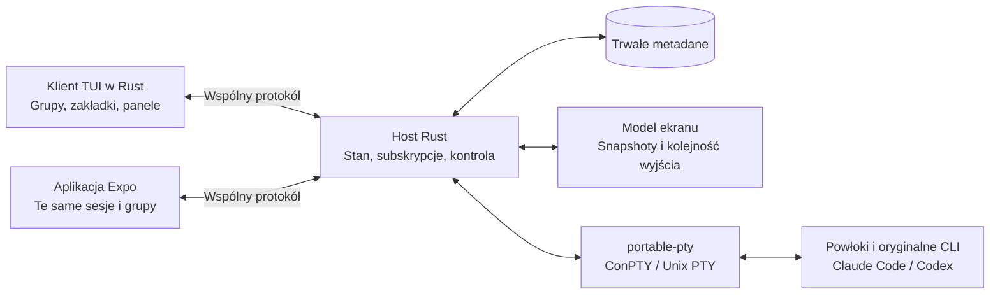

# Propozycja klienta terminalowego

**Status: projekt architektury, jeszcze niewdrożony.** Dokument opisuje kolejny etap Pocket Sessions. Obecna wersja nie zawiera klienta TUI, grup ani współdzielonych układów paneli.

Budujemy klienta terminalowego w Rust na Windowsa i macOS, obok aplikacji Expo. Kierunkiem interfejsu jest preferowany przez użytkownika Herdr: drzewo grup, czytelne zakładki, podzielony obszar pracy i szybkie przełączanie sesji. To inspiracja układem i obsługą; nie deklaracja zgodności z protokołem Herdr.

Na 16.10.2026 aktualny [Herdr](https://herdr.dev/) deklaruje natywne wsparcie Windows i macOS; jego [oficjalne repozytorium](https://github.com/herdrdev/herdr) jest napisane w Rust. [Agent Deck](https://github.com/asheshgoplani/agent-deck) opiera się na Go i tmux, a na Windowsie wskazuje WSL. U nas oba systemy otrzymają osobne natywne binarki z jednego kodu Rust. Budowanie i testy trzeba wykonywać na runnerach Windows i macOS; samo skompilowanie na Windowsie nie potwierdza obsługi macOS.

## Jeden host, dwa interfejsy

Procesy uruchamia wyłącznie host. Klient terminalowy i telefon otwierają widoki tych samych identyfikatorów sesji. Zamknięcie klienta pozostawia host i procesy aktywne. TUI może uruchomić osobny proces hosta przy pierwszym użyciu, ale nie przechowuje PTY we własnym procesie.

Pierwszy TUI korzysta z istniejącego transportu WebSocket i parowania. Nie wymaga tmux ani WSL do działania na Windowsie. Obsługa wielu komputerów będzie używała identyfikatorów sesji poprzedzonych identyfikatorem hosta; synchronizacja nie oznacza migracji procesu między komputerami.

## Wspólny model danych

| Obiekt | Znaczenie |
| --- | --- |
| `Group { id, parentId, name, order }` | Grupa lub podgrupa. Host odrzuca cykle i nieistniejącego rodzica. |
| `Workspace { id, rootPath }` | Katalog projektu, niezależny od grupowania widoków. Nie jest sandboxem. |
| `Window { id, groupId, title, order, layout }` | Obszar pracy prezentowany jako zakładka. Bez dodatkowej, dublującej encji `Tab`. |
| `Layout` | Drzewo podziałów poziomych/pionowych z proporcjami; liście wskazują panele. |
| `Pane { id, sessionId }` | Widok konkretnej sesji. Kilka paneli może wskazywać ten sam proces. |
| `Session { id, workspaceId, ... }` | Proces PTY należący do hosta, jego stan i rozmiar terminala. |

Grupy, kolejność i logiczne układy zapisuje host. Telefon może prezentować panele kolejno zamiast obok siebie, zachowując ich tożsamość. Fokus, przewijanie i otwarta klawiatura pozostają lokalne; ewentualne śledzenie aktywnego panelu drugiego urządzenia będzie osobną opcją.

Utworzenie sesji jest jednym żądaniem do hosta z `requestId`; odpowiedź wskazuje jej `sessionId`. Klienci nie dopasowują nowych procesów po nazwie ani nie tworzą lokalnych kopii sesji. Zmiany metadanych mają numer rewizji, aby konflikt dwóch edycji nie nadpisywał danych po cichu.

## Oglądanie, kontrola i rozmiar

`subscribe/unsubscribe` pozwalają jednemu klientowi oglądać wiele sesji. `acquire/releaseControl` nadają kontrolę nad konkretną sesją. Wielu obserwatorów może widzieć wyjście, ale w danej chwili tylko jeden kontroler wysyła wejście i zmienia rozmiar PTY.

Kontroler otrzymuje dzierżawę z identyfikatorem i generacją. Przejęcie sterowania, odłączenie lub wygaśnięcie dzierżawy unieważnia stare wejście. Operacja przejęcia jest jawna; wejście nie jest automatycznie powtarzane po reconnect. Kontrola dotyczy sesji i wybranego widoku, nie całego połączenia klienta.

PTY ma **jeden obowiązujący rozmiar**. Ustala go panel kontrolera. Obserwatorzy dopasowują podgląd przez przewijanie, kadrowanie lub skalowanie; nie wywołują resize. Przejęcie na telefonie może zmienić rozmiar procesu i musi zostać rozgłoszone do pozostałych widoków.

Host przechowuje model ekranu i wydaje snapshot wraz z numerem wyjścia, po którym klient odbiera kolejne zdarzenia. Odpowiedzi na zapytania terminalowe muszą mieć jednego właściciela; pasywne widoki nie mogą dopisywać odpowiedzi do powłoki. Sam parser ekranu nie rozwiązuje całej negocjacji terminala.

## Technologie i zapis

- **Ratatui + Crossterm:** układ TUI, rysowanie, klawiatura, mysz i resize. Crossterm obsługuje Windows oraz systemy Unix; Ratatui używa go domyślnie. Obecny Ratatui 0.30.2 wymaga Rust 1.88, podczas gdy host deklaruje 1.85 — minimum toolchainu trzeba ujednolicić. [Ratatui](https://docs.rs/ratatui/latest/ratatui/), [manifest](https://docs.rs/crate/ratatui/latest/source/Cargo.toml), [Crossterm](https://docs.rs/crossterm/latest/crossterm/).
- **portable-pty:** pozostaje na hoście, z Windows ConPTY i Unix PTY. TUI nie uruchamia własnego kontrolera procesów. [Dokumentacja](https://docs.rs/portable-pty/0.9.0/portable_pty/).
- **Silnik ekranu:** pierwszy kandydat to `vt100`, który udostępnia siatkę, tryby wejścia i snapshoty. Wybór finalny nastąpi po próbie zgodności z Claude Code, Codex, Unicode, alternate screen i ponownym dołączeniem. `alacritty_terminal` pozostaje kandydatem, jeżeli potrzebna będzie pełniejsza emulacja. [vt100](https://docs.rs/vt100/latest/vt100/), [stan ekranu](https://docs.rs/vt100/latest/vt100/struct.Screen.html), [Alacritty](https://docs.rs/alacritty_terminal/latest/alacritty_terminal/).
- **Renderer panelu:** można użyć `tui-term` albo niewielkiego renderera komórek Ratatui. `tui-term` 0.3 zależy od vt100 0.15, podczas gdy dostępny vt100 to 0.16; wersje trzeba dobrać świadomie. Eksperymentalny kontroler PTY tej biblioteki nie będzie używany. [Manifest tui-term](https://docs.rs/crate/tui-term/0.3.0/source/Cargo.toml), [ograniczenia](https://docs.rs/tui-term/0.3.0/tui_term/).
- **SQLite na hoście:** grupy, katalogi projektów, układy i konfiguracja sesji. Zapis metadanych nie oznacza przetrwania procesów po restarcie hosta lub komputera. Po restarcie można odtworzyć układ i oznaczyć sesje jako zakończone; uruchomienie nowego procesu wymaga osobnej operacji.

Kod Rust warto podzielić na wspólny protokół, bibliotekę modelu ekranu, host i klienta TUI. Aplikacja Expo pozostaje oddzielnym klientem tego samego kontraktu.

## Luki obecnej wersji

Host już przechowuje wspólną listę sesji, ale `attach` łączy oglądanie z kontrolą i zwalnia poprzednią sesję klienta. Wyjście trafia tylko do kontrolera. Nie ma wielu subskrypcji, trwałych grup, rewizji metadanych ani odpowiedzi powiązanych z `requestId`.

Obecne 128 KiB historii jest fragmentem strumienia wyjścia, a nie kompletnym snapshotem terminala. Dane sesji istnieją w pamięci; zapis parowania nie jest zapisem projektu ani układu.

## Cztery etapy z kryterium odbioru

1. **Protokół i wspólny stan.** Dodać `requestId`, grupy z podgrupami, okna i układy oraz zapis metadanych. Test: dwa klienty widzą te same identyfikatory i zmiany; równoczesne utworzenie sesji zwraca właściwe odpowiedzi; restart zachowuje układ, bez udawania żywych procesów.
2. **Obserwatorzy i przekazywanie kontroli.** Oddzielić subskrypcje, dzierżawę i resize. Test: dwa klienty oglądają dwie sesje równocześnie; tylko kontroler zmienia wejście/rozmiar; stare wejście po przejęciu zostaje odrzucone.
3. **Ekran i odtwarzanie.** Przeprowadzić próbę zgodności silnika, następnie wdrożyć snapshoty i uporządkowane wyjście. Test: dołączenie podczas intensywnego wyjścia, alternate screen, Unicode i zmiana rozmiaru nie gubią stanu ani nie powtarzają zapytań terminalowych do powłoki.
4. **Klient TUI i wspólny przebieg pracy.** Dodać drzewo grup, zakładki, podziały, fokus i tryby nawigacji/wpisywania. Test na Windowsie i macOS: utworzenie sesji w TUI, przejęcie tej samej powłoki na telefonie i powrót z zachowaną zmienną powłoki; wyjście z TUI nie kończy sesji hosta.
