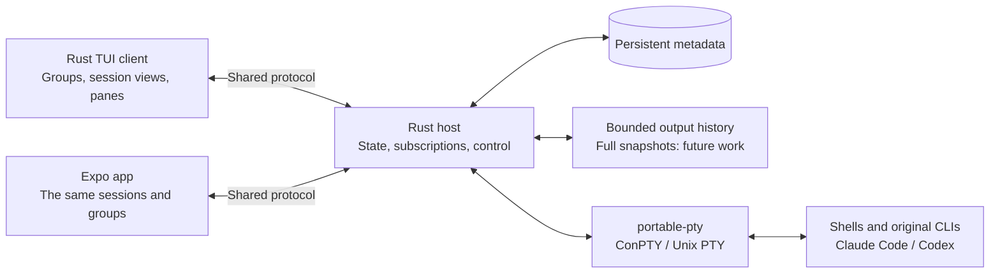

# Terminal client and synchronization

**Status: initial groups and synchronization implementation; the TUI client lives in `tui/`.** Shared groups, subgroups, session processes and control belong to the host. Pane layout is local to each client. Full screen snapshots and persistent window layouts remain future work.

The Rust terminal client provides a group tree, split panes and fast session switching alongside the Expo app. Windows and macOS receive separate native binaries from one Rust codebase. Builds and tests run on native CI runners; interactive terminal behavior needs separate verification on each platform.

## One host, two interfaces

Only the host starts processes. The terminal client and phone open views of the same session IDs. Closing a client leaves the host and processes running. At this stage, the host starts separately; the TUI does not own local PTYs. Commands and shortcuts are described in the [TUI guide](../tui/README.md).

The initial TUI uses the existing WebSocket transport and pairing. It does not require tmux or WSL on Windows. Support for multiple computers will use session IDs scoped by host ID; synchronization does not mean migrating a process between computers.

## Shared data model

| Object                                | Current implementation / future direction                                                                      |
| ------------------------------------- | -------------------------------------------------------------------------------------------------------------- |
| `Group { id, parentId, name, order }` | Implemented. The host rejects cycles and nonexistent parents; SQLite stores the metadata.                      |
| `Session { id, groupId, cwd, ... }`   | Implemented. A PTY process, state, controller and canonical dimensions.                                        |
| Workspace                             | Currently the initial directory selected by `--workspace`; a multi-project catalog is planned.                 |
| Window / Layout                       | Persistent windows and a split tree are planned. The initial TUI has a local view of one or two sessions.      |
| Pane                                  | A local view referencing `sessionId`, independent of the process. It is not a synchronized protocol v2 object. |

The host stores groups and their ordering. The phone opens one session at a time; the TUI can show two panes. Focus, scrolling and the open keyboard remain local. Persistent layouts and following another device's active pane will be separate features.

Creating a session is one host request with a `requestId`; the response identifies its `sessionId`. Clients do not match new processes by name or create local copies of sessions. Metadata changes carry a revision number so conflicting edits cannot silently overwrite data.

## Watching, control and dimensions

`subscribe/unsubscribe` let one client watch multiple sessions. `acquireControl/releaseControl` grant and release control of a specific session. Multiple viewers can receive output, but only one controller at a time sends input and changes PTY dimensions.

The controller receives a fresh random lease ID. Takeover or disconnection invalidates the old lease; a heartbeat detects lost connections. Takeover is explicit, and input is not automatically resent after reconnecting. Control applies to a session, not the client's entire connection.

The PTY has **one canonical size**, set by the controller's pane. Viewers adapt their presentation through scrolling, cropping or scaling; they do not send resize commands. Taking over on the phone can change the process dimensions, which must be broadcast to the other views.

The host currently stores a bounded output stream, which clients interpret in their own renderers. Full snapshots with an output sequence number are planned after engine compatibility testing. Terminal query responses have one owner; passive views must not write replies into the shell. The first acquisition on Windows replays ConPTY startup negotiation only to the controller.

## Technology and persistence

- **Ratatui + Crossterm:** TUI layout, drawing, keyboard, mouse and resize. Crossterm supports Windows and Unix systems; this client uses its 0.29 backend with Ratatui 0.30. Both host and TUI manifests declare Rust 1.88 as the minimum version. [Ratatui](https://docs.rs/ratatui/latest/ratatui/), [manifest](https://docs.rs/crate/ratatui/latest/source/Cargo.toml), [Crossterm](https://docs.rs/crossterm/latest/crossterm/).
- **portable-pty:** remains on the host, using Windows ConPTY and Unix PTYs. The TUI does not run its own process controller. [Documentation](https://docs.rs/portable-pty/0.9.0/portable_pty/).
- **TUI screen engine:** `vt100` 0.16 is implemented in the client, providing the cell grid, input modes and alternate-screen state. Compatibility with Claude Code, Codex, Unicode and reconnection still needs broader testing. This choice does not implement authoritative host screen snapshots. `alacritty_terminal` remains an option if fuller emulation becomes necessary. [vt100](https://docs.rs/vt100/latest/vt100/), [screen state](https://docs.rs/vt100/latest/vt100/struct.Screen.html), [Alacritty](https://docs.rs/alacritty_terminal/latest/alacritty_terminal/).
- **Pane renderer:** the TUI uses its own small Ratatui cell renderer over `vt100`. It does not use `tui-term` or that library's experimental PTY controller. Keeping process ownership on the host avoids creating separate local sessions. [Current renderer](../tui/src/terminal.rs).
- **SQLite on the host:** currently stores groups and revisions. Project catalogs, layouts and session configuration are planned. Persisting metadata does not make processes survive a host or computer restart. After restart, groups remain and the process list is empty.

The Rust code separates the wire codec, host and TUI, with terminal interpretation in the TUI's terminal module. A shared screen-model library can be introduced if the host snapshot implementation needs it. The Expo app remains a separate client of the same contract.

## Implemented behavior and remaining stages

Protocol v2 separates watching from control and supports multiple subscriptions, persistent groups, metadata revisions and `requestId`. Legacy `attach` remains for compatibility. The integration test starts a real host and multiple clients; it also checks stale-lease rejection and preservation of a shell variable after takeover.

The current 128 KiB history is a fragment of the output stream, not a complete terminal snapshot. Session data lives in memory; saved pairing data is not a saved project or layout.

## Acceptance criteria

1. **Protocol and shared state — implemented for groups and sessions.** Two clients see the same IDs and changes; session creation returns the matching `requestId`; restarting preserves groups. Persistent windows and layouts remain to be implemented.
2. **Viewers and control transfer — implemented.** Tests cover multiple subscriptions, one controller, resizing and rejection of stale input after takeover.
3. **Screen state and replay — remaining work.** Run engine compatibility checks, then implement snapshots and ordered output. Test that joining during heavy output, alternate-screen use, Unicode and resizing preserve state without repeating terminal queries into the shell.
4. **TUI and shared workflow — initial client implemented; broader validation remains.** The client has a group tree, local split panes, focus and navigation/input modes. Persistent windows and tabs are future work. Verify on Windows and macOS that a session created in the TUI can be taken over on the phone and returned with a shell variable intact, and that exiting the TUI leaves the host session running. Record completed checks separately in the [test matrix](testing.md).
